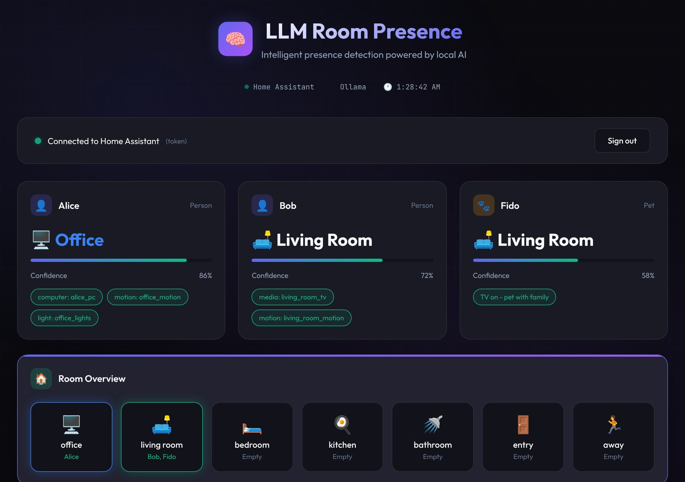
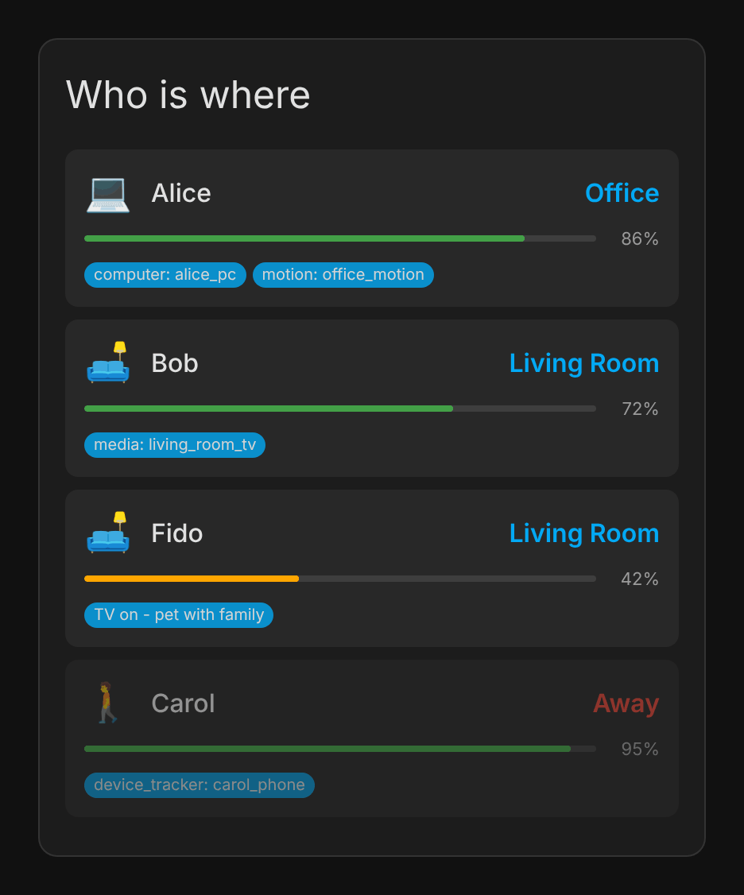

# WhoLLM

[](https://github.com/hacs/integration)
[](https://github.com/owens-ben/WhoLLM/releases)
[](https://github.com/owens-ben/WhoLLM/actions/workflows/test.yml)
[](https://opensource.org/licenses/MIT)
[](https://www.home-assistant.io/)

**A Home Assistant integration that uses local LLMs to determine *who* is in which room.**

> **Status: Alpha.** It runs, but expect rough edges. See the [roadmap](#roadmap) for what's done and what isn't wired up yet.



---

## The Problem

Occupancy sensors tell you a room is occupied. They don't tell you *who* is there.

Without person-level tracking, you can't:
- Apply personal lighting preferences when someone enters a room
- Know when the whole family is gathered in one place
- Send "you've been at your desk for 3 hours" reminders to a specific person
- Distinguish between a pet and a person triggering motion

## The Solution

WhoLLM uses a local LLM to reason across multiple weak signals, the same way people do:

```
Motion in office
+ Alice's PC is on
+ Alice's phone on home WiFi
+ Bob's car is gone
─────────────────────────────
→ Alice is in the office (high confidence)
```

No single sensor is definitive. Together, they're enough for a good guess.

---

## Features

- **Multi-person + pet tracking.** A room sensor and per-room binary sensors for everyone in the household.
- **Private by default.** Inference runs on your own [Ollama](https://ollama.com) server. Nothing leaves your network unless you choose the experimental CrewAI provider.
- **Confidence and reasons.** Every guess carries a 0–1 confidence and the signals behind it (`computer: alice_pc`, `motion: office_motion`, ...).
- **Combined signals.** The LLM's answer is weighed against sensor indicators and learned habits, with weights you can tune.
- **Keeps working without the LLM.** If Ollama is slow or down, WhoLLM falls back to sensor heuristics.
- **Habit learning.** Confident guesses teach it each person's usual rooms by time of day.
- **Corrections.** `whollm.correct_room` fixes a wrong guess and feeds the correction back into habit learning.
- **Arrival, departure and room-change events** for your own automations, plus ready-made [blueprints](#blueprints).
- **Vision identification (optional).** Ask a vision model who is on a camera.
- **Two dashboards.** A [Lovelace card](#lovelace-card) and a [standalone web dashboard](#standalone-dashboard).

---

## Installation

### Prerequisites

1. **Home Assistant 2024.1+**
2. **Ollama** running locally or on your network:
   ```bash
   curl -fsSL https://ollama.com/install.sh | sh
   ollama pull llama3.2        # Text reasoning (~2GB)
   ollama pull moondream       # Optional: vision identification (~1.7GB)
   ```

### Via HACS (Recommended)

1. Open HACS → Integrations → ⋮ Menu → Custom repositories
2. Add `https://github.com/owens-ben/WhoLLM` as an Integration
3. Search for "WhoLLM" and install
4. Restart Home Assistant
5. Go to Settings → Devices & Services → Add Integration → WhoLLM

### Manual Installation

1. Download the `custom_components/whollm` folder from this repository
2. Copy it to your Home Assistant `config/custom_components/` directory
3. Restart Home Assistant
4. Add the integration via Settings → Devices & Services

---

## Configuration

The setup wizard asks for:

| Option | Description | Default |
|--------|-------------|---------|
| **Provider** | `ollama`, or `crewai` (experimental) | `ollama` |
| **URL** | Provider server URL | `http://localhost:11434` |
| **Model** | Model used for reasoning | `llama3.2` |
| **Poll Interval** | Seconds between updates | `10` |
| **Rooms** | Rooms to track (pick from a list or add your own) | — |
| **Persons** | People to track, comma-separated | — |
| **Pets** | Pets to track, comma-separated (optional) | — |
| **Room entities** | Sensors that indicate activity in each room | — |

After setup, **Configure** on the integration lets you change:

- **General:** poll interval, LLM timeout (default 30s), pattern learning, and arrival/departure events
- **Room entities:** which sensors belong to which room
- **Person devices:** which devices belong to which person
- **Confidence weights:** how much each kind of signal counts

### Room-Entity Mapping

Tell WhoLLM which sensors indicate activity in each room:

- **Motion sensors:** `binary_sensor.office_motion`
- **Lights:** `light.office_lights`
- **Media players:** `media_player.living_room_tv`
- **Computers:** `switch.alice_pc`, `device_tracker.alice_pc`
- **Doors:** `binary_sensor.front_door`
- **Cameras with AI detection:** cameras that detect people or animals

### Person-Device Mapping

Associate devices with specific people:
- Alice's phone → `device_tracker.alice_iphone`. If all of a person's trackers say they're away, WhoLLM marks them `away` without asking the LLM.
- Alice's PC → `switch.alice_pc`. When it's on, it counts as extra evidence for Alice specifically.
- Bob's car → `device_tracker.bob_car`

---

## Entities Created

### Sensors

| Entity | Description |
|--------|-------------|
| `sensor.{name}_room` | Current room for each person/pet (`away` when not home) |
| `sensor.vision_last_identification` | Last camera identification result |

**Room sensor attributes:**
- `confidence`: 0.0–1.0
- `indicators`: signals that contributed to the guess
- `raw_response`: the LLM's raw answer
- `entity_type`: `person` or `pet`

### Binary Sensors

| Entity | Description |
|--------|-------------|
| `binary_sensor.{name}_in_{room}` | Whether a person/pet is in a specific room |

Example: `binary_sensor.alice_in_office`, `binary_sensor.fido_in_living_room`

---

## Services

### `whollm.correct_room`

Correct a wrong guess. The sensor updates right away and the habit learner records the correction.

```yaml
service: whollm.correct_room
data:
  entity_id: sensor.alice_room
  room: office
```

### `whollm.refresh`

Run presence detection now instead of waiting for the next poll.

### `whollm.get_history` / `whollm.get_patterns`

Return recent room transitions or detected movement patterns for a person. These are response-only, so call them from Developer Tools → Actions or from a script with `response_variable`.

```yaml
service: whollm.get_history
data:
  entity_name: Alice
  limit: 20
response_variable: history
```

### `whollm.clear_history`

Clear transition history for one person (`entity_name`) or for everyone.

### `whollm.identify_person`

Ask the vision model who is on a camera.

```yaml
service: whollm.identify_person
data:
  camera_entity_id: camera.living_room
  detection_type: person  # or "animal"
```

### `whollm.enable_tracking` / `whollm.disable_tracking`

Control camera auto-tracking for PTZ cameras.

```yaml
service: whollm.enable_tracking
data:
  camera_name: e1_zoom
```

### `whollm.cleanup_storage`

Trim the event log by age and size. This also runs daily.

## Events

WhoLLM fires these on the HA event bus. You can turn them off in the integration options.

| Event | Data |
|-------|------|
| `whollm_person_arrived` | `entity_name`, `room`, `confidence`, `timestamp` |
| `whollm_person_left` | `entity_name`, `last_room`, `timestamp` |
| `whollm_room_changed` | `entity_name`, `from_room`, `to_room`, `confidence`, `timestamp` |

Nothing fires for the first reading after a restart, so a restart doesn't announce everyone as arrived.

---

## Blueprints

Ready-made automations. Each one has an import button in [`blueprints/`](blueprints/README.md).

| Blueprint | What it does |
|-----------|--------------|
| **Activity Log** | Posts every room change to Slack, Discord or a phone, with confidence and reasons. Low-confidence guesses are flagged, which makes it handy while tuning. |
| **Welcome Home Lights** | Turns on lights in the room someone arrives in |
| **Goodbye Routine** | Lights off, doors locked and thermostat set when someone leaves |
| **Follow Me Music** | Moves music playback from room to room |
| **Room-Based Climate** | Adjusts temperature for occupied rooms |

An Activity Log post looks like this:

> **Alice**: kitchen → office (86%) · computer: alice_pc, motion: office_motion
> ⚠️ **Fido**: bedroom → living room (42%) · TV on - pet with family

---

## Dashboards

### Lovelace Card



A card for your existing Home Assistant dashboards.

1. Copy [`www/whollm-card.js`](www/whollm-card.js) to `config/www/whollm-card.js`
2. Add it as a resource (Settings → Dashboards → ⋮ → Resources): URL `/local/whollm-card.js`, type **JavaScript module**
3. Add the card:

```yaml
type: custom:whollm-card
title: Who is where
entities:
  - sensor.alice_room
  - sensor.bob_room
  - sensor.fido_room
```

Set `show_confidence: false` or `show_indicators: false` to hide those rows.

<br clear="right">

### Standalone Dashboard

The full-screen dashboard at the top of this page runs in Docker, outside Home Assistant, and signs in with your HA account:

```bash
cd dashboard
HA_URL=http://homeassistant.local:8123 docker compose up -d
```

Then open `http://<host>:3380`. See [`dashboard/README.md`](dashboard/README.md) for details.

---

## Example Automations

### Personal Lighting Preferences

```yaml
automation:
  - alias: "Alice's office lighting"
    trigger:
      - platform: state
        entity_id: binary_sensor.alice_in_office
        to: "on"
    action:
      - service: light.turn_on
        target:
          entity_id: light.office
        data:
          brightness_pct: 80
          color_temp_kelvin: 4000
```

### Family Movie Night Detection

```yaml
automation:
  - alias: "Everyone in living room"
    trigger:
      - platform: template
        value_template: >
          {{ is_state('binary_sensor.alice_in_living_room', 'on') and
             is_state('binary_sensor.bob_in_living_room', 'on') }}
    action:
      - service: scene.turn_on
        target:
          entity_id: scene.movie_mode
```

### Desk Time Reminder

```yaml
automation:
  - alias: "Alice desk reminder"
    trigger:
      - platform: state
        entity_id: binary_sensor.alice_in_office
        to: "on"
        for:
          hours: 3
    action:
      - service: notify.alice_phone
        data:
          message: "You've been at your desk for 3 hours. Time for a break!"
```

### Welcome Message on Arrival

```yaml
automation:
  - alias: "Welcome home"
    trigger:
      - platform: event
        event_type: whollm_person_arrived
    action:
      - service: notify.family
        data:
          message: "{{ trigger.event.data.entity_name }} is home ({{ trigger.event.data.room }})"
```

---

## How It Works

On every poll, WhoLLM runs this for each person and pet:

```
                    ┌──────────────────────────┐
  Device trackers ─▶│ All trackers say away?   │── yes ──▶ room = away
                    └────────────┬─────────────┘
                                 │ no
  Motion, lights,                ▼
  media, computers, ┌──────────────────────────┐
  doors, cameras ──▶│ Build context + habits   │
                    └────────────┬─────────────┘
                                 ▼
                    ┌──────────────────────────┐
                    │ Ask the LLM              │── error/timeout ──▶ sensor heuristics
                    └────────────┬─────────────┘                            │
                                 ▼                                          │
                    ┌──────────────────────────┐◀───────────────────────────┘
                    │ Combine: LLM + sensor    │
                    │ indicators + habits      │
                    │ (confidence weights)     │
                    └────────────┬─────────────┘
                                 ▼
         sensors · events · history · habit learning · event log
```

---

## Data and Privacy

Everything stays in your Home Assistant config directory:

| File | Contents |
|------|----------|
| `whollm_events.jsonl` | Each guess with its sensor context (kept 30 days / 100 MB by default) |
| `whollm_learned_habits.json` | Learned room-by-time-of-day patterns |
| `whollm_history.json` | Recent room transitions |

The event log is meant for training a per-household model later (see [roadmap](#roadmap)). Shrink it with `whollm.cleanup_storage` or the retention options.

---

## Troubleshooting

### "Timeout" or low confidence predictions

The LLM is taking too long to respond. Try:
- A smaller model: `ollama pull llama3.2:1b`
- Checking Ollama is running: `curl http://localhost:11434/api/tags`
- A longer poll interval or LLM timeout in the integration options

### Integration not loading

Check the Home Assistant logs:
```
Settings → System → Logs → Filter by "whollm"
```

Common causes:
- Ollama URL incorrect or unreachable
- Missing model (run `ollama pull <model>`)

### Predictions seem wrong

1. Check the sensor's `indicators` attribute to see which signals were used
2. Make sure the room-entity and person-device mappings are right
3. Add the Activity Log blueprint and watch where it's unsure
4. Use `whollm.correct_room` when it's wrong, so habit learning picks it up

### Vision identification not working

- WhoLLM uses the `moondream` vision model: `ollama pull moondream`
- Check the camera entity is accessible from Home Assistant

---

## Performance Tips

| Scenario | Recommendation |
|----------|----------------|
| Slow predictions | Use a smaller model (`llama3.2:1b`, `phi3:mini`) |
| High CPU usage | Raise the poll interval to 60+ seconds |
| GPU available | Configure Ollama to use the GPU |
| Many people/rooms | Use a dedicated Ollama instance |

---

## Roadmap

Done:
- [x] Lovelace card and standalone dashboard
- [x] Services for corrections, history and patterns
- [x] Arrival, departure and room-change events
- [x] Automation blueprints

Code exists, not wired in yet:
- [ ] Multi-zone tracking (work, gym, school; `zones.py`)
- [ ] Per-household ML model (`ml_predictor.py` and `scripts/train_*.py`)
- [ ] OpenAI and Anthropic providers (they need an API-key step in setup)

Planned:
- [ ] Event-driven updates instead of polling
- [ ] Prompt evaluation against logged events
- [ ] Faster face recognition as an alternative to the vision LLM

See [`docs/PLAN.md`](docs/PLAN.md) for the full plan.

---

## Contributing

Contributions welcome! See [CONTRIBUTING.md](CONTRIBUTING.md) for guidelines and [DEVELOPMENT.md](DEVELOPMENT.md) for running it against your own Home Assistant.

Areas that need help:
- **Prompt engineering:** better prompts mean better accuracy
- **Testing:** especially with real households
- **Documentation:** examples and troubleshooting guides

---

## Acknowledgments

- [Ollama](https://ollama.com), for making local LLMs accessible
- [Area Occupancy Detection](https://github.com/Hankanman/Area-Occupancy-Detection), the inspiration for room-level presence

---

## License

MIT License. See [LICENSE](LICENSE) for details.
