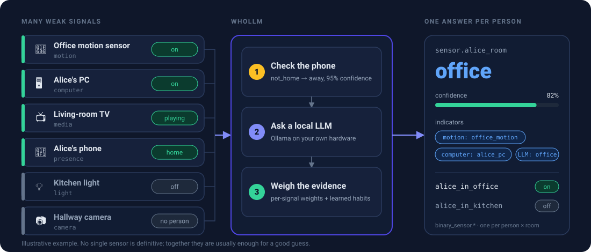
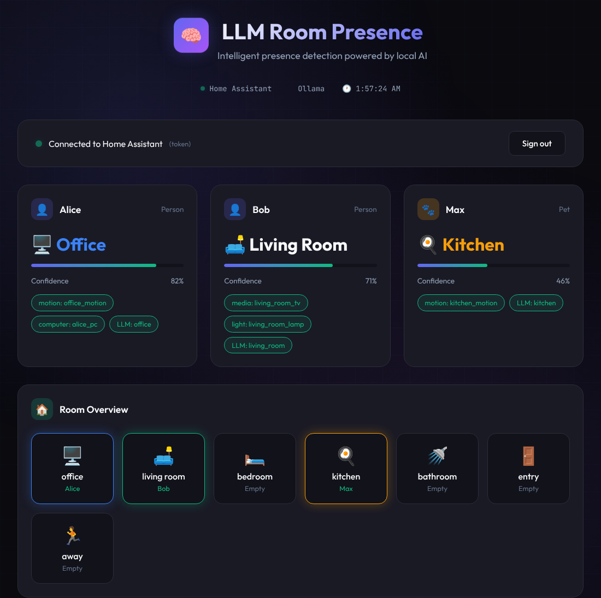
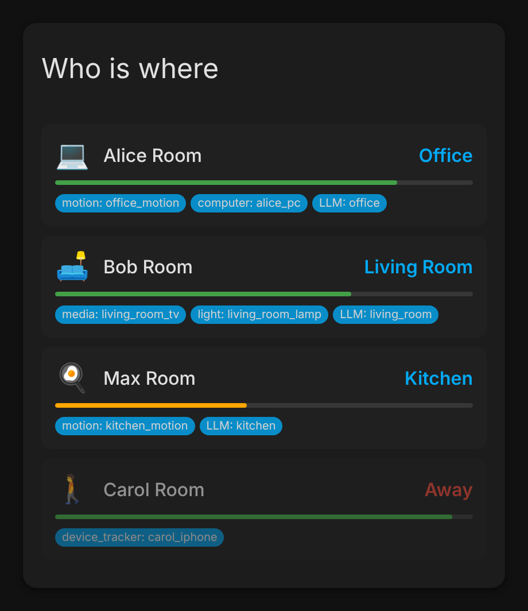

# WhoLLM

[](https://github.com/hacs/integration)
[](https://github.com/owens-ben/WhoLLM/releases)
[](https://opensource.org/licenses/MIT)
[](https://www.home-assistant.io/)

**Know *who* is in which room, not just that a room is occupied.**
A Home Assistant integration that uses a local LLM to turn many weak signals into one answer per person and pet.

> **Status: Alpha (v0.1.0).** The core detection works. Some finished code is not connected yet.
> See [what works today](docs/status.md).



## Why

Occupancy sensors tell you a room is occupied. They do not tell you *who* is there, so you cannot:

- apply personal lighting when a particular person walks in,
- know when the whole family is in one place,
- nudge one person after three hours at their desk,
- tell a pet from a person.

No single sensor is definitive. Together (motion, a PC that is on, a TV playing, a phone on Wi-Fi) they usually are.
WhoLLM weighs them the way a person would, with a local LLM in the loop.

## What you get

- **A room per person and pet**: `sensor.alice_room`, plus `binary_sensor.alice_in_office` for every room.
- **Private by design**: inference runs on your own network through [Ollama](https://ollama.com).
- **Evidence you can read**: every answer carries a confidence number and the `indicators` behind it.
- **Sensible fallbacks**: a phone that is away means `away`. If the LLM is unreachable, a rule-based guess takes over.
- **Habit hints**: learns where people usually are at what time (kept in memory for now).
- **Optional camera identification** with a local vision model.
- **Ready-made screens and automations**: a Lovelace card, two dashboards and blueprints.

| Standalone dashboard | Lovelace card |
|---|---|
|  |  |

*Rendered from the real code with demo data.*

## Quick start

You need Home Assistant 2024.1 or newer and [Ollama](https://ollama.com) reachable from it.

1. **Get a model**

   ```bash
   curl -fsSL https://ollama.com/install.sh | sh
   ollama pull llama3.2
   ```

2. **Install through HACS**: HACS, then ⋮, then *Custom repositories*, add
   `https://github.com/owens-ben/WhoLLM` as an **Integration**, install **WhoLLM** and restart Home Assistant.
   (Prefer manual? Copy `custom_components/whollm` into your `config/custom_components/`.)

3. **Add it**: *Settings, Devices & Services, Add Integration, WhoLLM*, and follow the five-step wizard. Map your
   sensors to rooms when asked. That step matters most.

4. **Check**: in *Developer Tools, States*, look for `sensor.<name>_room`.

5. **Automate**:

   ```yaml
   automation:
     - alias: "Alice's office lighting"
       trigger:
         - platform: state
           entity_id: binary_sensor.alice_in_office
           to: "on"
       action:
         - service: light.turn_on
           target:
             entity_id: light.office
           data:
             brightness_pct: 80
   ```

The full walkthrough, with what to type at every step, is in **[Getting started](docs/getting-started.md)**.

## Documentation

| | |
|---|---|
| **[Getting started](docs/getting-started.md)** | Install, run the wizard, verify, first automation. |
| **[Configuration](docs/configuration.md)** | Every setting, entity mapping, device ownership, weights, storage. |
| **[How it works](docs/how-it-works.md)** | The detection pipeline, how confidence is computed, why it picked that room. |
| **[Entities & services](docs/entities-and-services.md)** | Sensor names, attributes, events and services. |
| **[Automations](docs/automations.md)** | Recipes and blueprints. |
| **[Dashboard](docs/dashboard.md)** | The Lovelace card, the YAML dashboard and the standalone web dashboard. |
| **[Troubleshooting](docs/troubleshooting.md)** | Symptom to cause to fix, plus performance tips. |
| **[Status & roadmap](docs/status.md)** | What is finished, what is not connected yet, known issues. |
| **[Development](docs/development.md)** | Dev setup, tests, repo map, regenerating the docs images. |
| **[ML & training data](docs/ml-and-training-data.md)** | The event log and the experimental training scripts. |

Start at the [guide home](docs/README.md) if you are not sure where to look.

## Contributing

Contributions are welcome. See [CONTRIBUTING.md](CONTRIBUTING.md) and the [development guide](docs/development.md).
Areas that need help: prompt engineering, tests, documentation, and connecting the finished-but-unused modules listed
in [Status](docs/status.md).

## Acknowledgments

- [Ollama](https://ollama.ai), for making local LLMs accessible.
- [Area Occupancy Detection](https://github.com/Hankanman/Area-Occupancy-Detection), the inspiration for room-level
  presence.

## License

MIT License. See [LICENSE](LICENSE).
