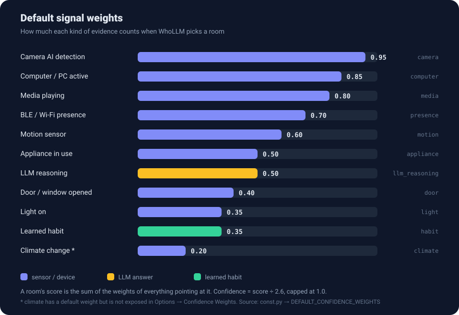

# Configuration

[← Getting started](getting-started.md) · [Guide home](README.md) · Next: [How it works →](how-it-works.md)

Everything you can set, what it does, and the traps to avoid.

## Where each setting lives

| Setting | Set in | Change later? |
|---|---|---|
| Provider, URL, model | Setup wizard | Remove and re-add the integration |
| Rooms | Setup wizard | Remove and re-add the integration |
| People and pets | Setup wizard | Remove and re-add the integration |
| Room entities | Wizard, then **Configure → Room Entity Mapping** | Yes |
| Person device ownership | **Configure → Person Device Ownership** | Yes |
| Confidence weights | **Configure → Confidence Weights** | Yes |
| Poll interval, LLM timeout, learning | Wizard (poll interval only), then **Configure → General Settings** | Yes |

> [!IMPORTANT]
> After saving anything under **Configure**, reload the integration (Settings → Devices & Services → WhoLLM →
> ⋮ → **Reload**). Options are read at startup and there is no automatic reload yet.

> [!WARNING]
> **Known issue:** each *Configure* page saves only its own values and replaces what the other pages saved. In
> practice, the last page you saved is the one that sticks. Re-open the other pages after saving and check them.
> See [Status & roadmap](status.md#known-issues).

## Setup wizard reference

| Field | Default | Notes |
|---|---|---|
| Provider | `ollama` | `ollama` or `crewai` (experimental, see [CrewAI](#crewai-experimental)). |
| Provider URL | `http://localhost:11434` | The wizard always pre-fills the Ollama URL, even if you pick `crewai`. |
| Poll interval | 10 s | Slider from 5 to 300 seconds in steps of 5. See [Choosing a poll interval](#choosing-a-poll-interval). |
| Model | first model Ollama lists | Free text also accepted. |
| Rooms | office, living room, bedroom, kitchen, bathroom, entry | Plus custom rooms. Sanitised to lower-case, underscores, letters, digits and hyphens. |
| People / Pets | none | Comma-separated. At least one person or pet. |
| Room entities | none | Per room. Entities that do not exist yet are skipped (a warning is logged). |

`away` and `unknown` are not rooms you pick. WhoLLM produces them itself.

## General settings

**Configure → General Settings**

| Option | Default | Range | What it does |
|---|---|---|---|
| Poll interval | 10 s | 5–300 s | How often a full round of detection runs. |
| LLM request timeout | 30 s | 5–120 s | How long to wait for the provider before falling back to a rule-based guess. |
| Enable pattern learning | on | | Whether confident predictions teach the [habit](how-it-works.md#habits) hints. |

### Choosing a poll interval

Each poll makes **one LLM request per person and pet, one after another**. A failed request is retried once after a
short pause.

> poll interval ≳ (people + pets) × typical response time

Four people and a dog at 3 seconds each is 15 seconds of work, so a 10 second poll cannot keep up. Use a faster
model, a GPU, or a longer interval. See [Performance](troubleshooting.md#performance).

## Room entity mapping

**Configure → Room Entity Mapping.** For every room, pick the entities that show activity there. WhoLLM reads *only*
the entities you map here (and the ones you assign to people), not your whole home.

You can choose from these domains: `binary_sensor`, `sensor`, `light`, `switch`, `media_player`, `device_tracker`,
`camera`.

Good things to map:

| In the room | Example |
|---|---|
| Motion or occupancy sensors | `binary_sensor.office_motion` |
| Lights | `light.office` |
| TVs and speakers | `media_player.living_room_tv` |
| PC power or presence | `switch.alice_pc`, `binary_sensor.alice_pc_active` |
| Doors and windows | `binary_sensor.front_door` |
| Cameras with person/animal AI | `binary_sensor.hallway_person` |

### Hint types are guessed from the entity ID

You never choose a signal type. WhoLLM guesses it **once, when you save**, by looking for text inside the entity ID.
The first rule that matches wins:

| # | If the entity ID contains… | Treated as | Default weight |
|---|---|---|---|
| 1 | `motion` or `occupancy` | motion | 0.60 |
| 2 | `media_player` or `tv` | media | 0.80 |
| 3 | `light.` | light | 0.35 |
| 4 | `pc`, `computer` or `desktop` | computer | 0.85 |
| 5 | `camera`, `person` or `animal` | camera | 0.95 |
| 6 | `door`, `window` or `contact` | door | 0.40 |
| 7 | `temperature` or `humidity` | climate | 0.20 |
| 8 | `device_tracker` | presence | 0.70 |
| 9 | anything else | appliance | 0.50 |

Because it is plain substring matching, surprises happen:

| Entity | You might expect | You get | Why |
|---|---|---|---|
| `light.tv_backlight` | light | **media** | `tv` is checked before `light.` |
| `device_tracker.alice_pc` | presence | **computer** | `pc` is checked before `device_tracker` |
| `binary_sensor.garage_door_motion` | door | **motion** | `motion` is checked first |

If a guess is wrong, rename the entity ID (or pick a better-named entity) and save the mapping again.

### What counts as "active"

A mapped entity contributes evidence only while its state is one of `on`, `home`, `detected`, `playing`, `open` or
`occupied`. Media players also count while `paused`. Numeric sensors such as temperature never count as active; they
are only shown to the LLM as context.

## Person device ownership

**Configure → Person Device Ownership.** Pick entities that belong to each person and pet.

- **Away detection (people only).** If any assigned entity is a `device_tracker`, WhoLLM looks at all of them. When
  **every** tracker is away, the person is `away` with confidence 0.95 and the LLM is skipped. Any zone other than
  `home` (for example `work`) counts as away. Unavailable trackers are ignored, and if all are unavailable the check
  makes no decision.
- **Extra weight.** If an assigned device is active **and** also appears in Room Entity Mapping, it counts a second
  time for that person, toward the room it is mapped to. Whatever kind of device it is, this second count uses the
  **computer** weight (0.85 by default). A device that is not mapped to a room is ignored for this purpose.

> [!TIP]
> Putting a phone's `device_tracker` under a person gives you away detection. It adds nothing to room detection
> unless you also map it to a room.

Why this matters in multi-person homes: see
[Shared signals](how-it-works.md#shared-signals-in-multi-person-homes).

## Confidence weights

**Configure → Confidence Weights.** Sliders from 0 to 100 % in steps of 5, one per signal type.

- Higher means that kind of evidence moves the answer more.
- Saving this page stores **all** the sliders and replaces the defaults, so check each one before saving.
- Confidence is divided by the sum of your three largest weights, so lowering your biggest weights makes overall
  confidence read higher. Details in [How it works](how-it-works.md#signals-weights-and-confidence).

## What gets stored on disk

| File | What | Notes |
|---|---|---|
| `/config/whollm_events.jsonl` | One record per person per poll, plus room moves and vision results | Used as ML training data. Trimmed at startup and every 24 h. |
| `/config/whollm_learned_habits.json` | Learned habit patterns | Loaded at startup if present. See [Status](status.md#known-issues): patterns are not saved automatically yet. |

Retention defaults to **30 days** and **100 MB**. There is no UI for these limits; the
[`whollm.cleanup_storage`](entities-and-services.md#whollmcleanup_storage) service can apply different limits on demand.
At short poll intervals the file grows quickly, and the size limit will trim the oldest entries first.

> [!NOTE]
> Both paths are fixed at `/config/...`, which is right for Home Assistant OS, Supervised and the standard container
> image. Home Assistant Core installs with a different config directory are not supported yet.

## CrewAI (experimental)

The `crewai` provider talks to **your own** CrewAI-style HTTP API instead of Ollama:

- It checks `GET {url}/` for `{"status": "ok"}`, lists models from `GET {url}/models`, and asks
  `POST {url}/presence/detect`.
- Typical URL is `http://localhost:8502`. The wizard does not pre-fill it, so type it in.
- Model names are whatever your API exposes (`haiku`, `sonnet`, `opus`, or an Ollama model).

If you do not already run such an API, use Ollama.

## Vision

Camera identification uses an Ollama vision model. It defaults to **`moondream`** (fast, about 5–15 s on CPU) and is
not yet selectable in the UI. See [Entities & services → identify_person](entities-and-services.md#whollmidentify_person).
