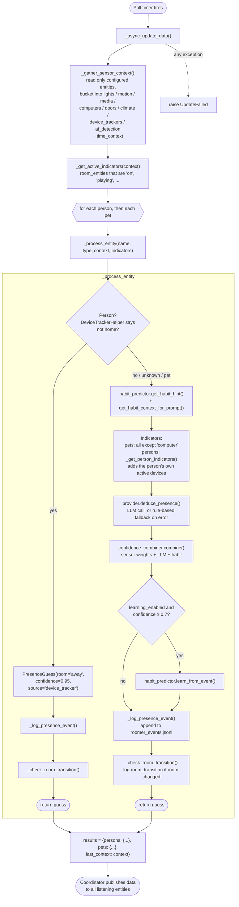
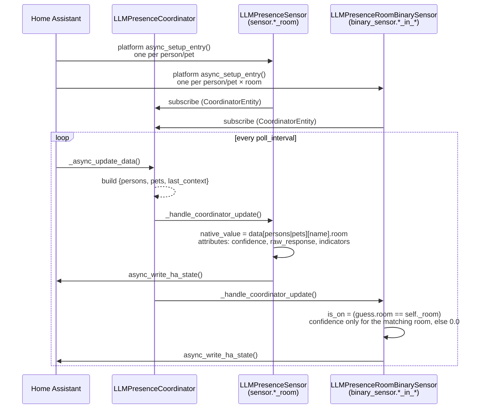

# Architecture

This page explains how Roomer is put together: which file does what, what happens on every poll, and how the entities you see in Home Assistant get their values. Read it before you change anything in `custom_components/roomer/`.

If you are new to Home Assistant integration development, three HA concepts carry most of the weight here:

- **Config entry**: the saved result of the setup wizard (`entry.data`) plus anything changed later in the options flow (`entry.options`).
- **`DataUpdateCoordinator`**: an HA helper that calls one `_async_update_data()` method on a timer and hands the result to every entity that subscribes to it. Entities never poll on their own.
- **`CoordinatorEntity`**: a base class for entities that re-render whenever the coordinator publishes new data.

## Module map

### `custom_components/roomer/`

| File | What it does |
| --- | --- |
| [`__init__.py`](https://github.com/owens-ben/roomer/blob/main/custom_components/roomer/__init__.py) | Integration entry point. `async_setup_entry` builds the `EventLogger`, `HabitPredictor`, `ConfidenceCombiner` and the coordinator, runs the first refresh, schedules daily storage cleanup, creates the vision helpers, registers services through `services.py`, forwards setup to the `sensor` and `binary_sensor` platforms, and registers the options update listener. |
| [`coordinator.py`](https://github.com/owens-ben/roomer/blob/main/custom_components/roomer/coordinator.py) | `LLMPresenceCoordinator`, the core polling loop, plus `DeviceTrackerHelper` (works out "home / away / unknown" from a person's `device_tracker.*` entities). |
| [`config_flow.py`](https://github.com/owens-ben/roomer/blob/main/custom_components/roomer/config_flow.py) | `LLMPresenceConfigFlow` (setup wizard: provider → model → rooms → persons → room entities) and `LLMPresenceOptionsFlow` (general settings, room entities, person devices, confidence weights). |
| [`const.py`](https://github.com/owens-ben/roomer/blob/main/custom_components/roomer/const.py) | Config keys, defaults, entity hint types, `DEFAULT_CONFIDENCE_WEIGHTS`, provider names and `SUPPORTED_PROVIDERS`. |
| [`habits.py`](https://github.com/owens-ben/roomer/blob/main/custom_components/roomer/habits.py) | `HabitPredictor` (learns which room someone is usually in for each two-hour slot) and `ConfidenceCombiner` (merges sensor, LLM and habit signals into a final room and confidence). Also `calculate_time_decay`. |
| [`event_logger.py`](https://github.com/owens-ben/roomer/blob/main/custom_components/roomer/event_logger.py) | `EventLogger`: appends presence, room-transition and vision events to a JSONL file for later ML training, and handles retention and size-based cleanup. |
| [`sensor.py`](https://github.com/owens-ben/roomer/blob/main/custom_components/roomer/sensor.py) | `LLMPresenceSensor` (one "*Name* Room" sensor per person or pet) and `LLMVisionSensor` (last vision identification, driven by an HA event rather than the coordinator). |
| [`binary_sensor.py`](https://github.com/owens-ben/roomer/blob/main/custom_components/roomer/binary_sensor.py) | `LLMPresenceRoomBinarySensor`: one occupancy binary sensor for every person or pet × room combination. |
| [`vision.py`](https://github.com/owens-ben/roomer/blob/main/custom_components/roomer/vision.py) | `VisionIdentifier` (takes a camera snapshot, sends it to an Ollama vision model, parses who it sees) and `CameraTrackingController` (switches camera auto-tracking on and off). |
| [`history.py`](https://github.com/owens-ben/roomer/blob/main/custom_components/roomer/history.py) | `HistoryTracker`: room-transition history, daily timelines, room statistics and simple pattern detection. Owned by the coordinator, which records every transition; read by the `get_history`, `get_patterns` and `clear_history` services. |
| [`notifications.py`](https://github.com/owens-ben/roomer/blob/main/custom_components/roomer/notifications.py) | `NotificationManager`: fires `roomer_person_arrived`, `roomer_person_left` and `roomer_room_changed` events on room changes. Owned by the coordinator and called from `_check_room_transition()`. The first room it sees for someone only sets a baseline. |
| [`zones.py`](https://github.com/owens-ben/roomer/blob/main/custom_components/roomer/zones.py) | `ZoneManager`: maps device-tracker states to HA zones (home, work, ...). Not used by the coordinator, which uses `DeviceTrackerHelper` instead. |
| [`ml_predictor.py`](https://github.com/owens-ben/roomer/blob/main/custom_components/roomer/ml_predictor.py) | `MLPredictor`: loads per-person scikit-learn models and predicts a room with an uncertainty flag. Not wired in; see [`ml_predictor.py`](#ml_predictorpy). |
| [`services.py`](https://github.com/owens-ben/roomer/blob/main/custom_components/roomer/services.py) | Schemas and handlers for all nine services, and `async_setup_services()`, which registers them (once, even with several entries). Handlers find the coordinator's `HabitPredictor` and `HistoryTracker` through `hass.data["roomer"][entry_id]`; the vision helpers and event logger come from their fixed keys. |
| [`services.yaml`](https://github.com/owens-ben/roomer/blob/main/custom_components/roomer/services.yaml) | Service descriptions shown in the HA UI. Must list exactly the services `services.py` registers; `tests/test_wiring.py` checks this. |
| [`strings.json`](https://github.com/owens-ben/roomer/blob/main/custom_components/roomer/strings.json), `translations/` | UI text for the config and options flows. |
| [`manifest.json`](https://github.com/owens-ben/roomer/blob/main/custom_components/roomer/manifest.json) | Integration metadata read by HA and HACS: domain `roomer`, version, `iot_class: local_polling`, requirements. |

### `custom_components/roomer/providers/`

| File | What it does |
| --- | --- |
| [`base.py`](https://github.com/owens-ben/roomer/blob/main/custom_components/roomer/providers/base.py) | `PresenceGuess` dataclass, the abstract `BaseLLMProvider` (shared HTTP session, retry helper, prompt formatting, indicator extraction, rule-based fallback guess) and the module-level `parse_llm_response()`. |
| [`__init__.py`](https://github.com/owens-ben/roomer/blob/main/custom_components/roomer/providers/__init__.py) | The `_PROVIDERS` registry and the `get_provider()` / `get_available_providers()` factory functions. |
| [`ollama.py`](https://github.com/owens-ben/roomer/blob/main/custom_components/roomer/providers/ollama.py) | `OllamaProvider`: calls `POST /api/generate` on a local Ollama server. The default provider. |
| [`crewai.py`](https://github.com/owens-ben/roomer/blob/main/custom_components/roomer/providers/crewai.py) | `CrewAIProvider`: calls a self-hosted CrewAI API (experimental). |
| [`openai.py`](https://github.com/owens-ben/roomer/blob/main/custom_components/roomer/providers/openai.py) | `OpenAIProvider`: implemented and unit-tested but **not registered**, because the config flow has no API-key step yet. |
| [`anthropic.py`](https://github.com/owens-ben/roomer/blob/main/custom_components/roomer/providers/anthropic.py) | `AnthropicProvider`: same status as OpenAI. |

## Setup

When HA loads a Roomer config entry, `async_setup_entry` in `__init__.py`:

1. Builds one `EventLogger` (with the configured retention days and maximum file size), one `HabitPredictor` and one `ConfidenceCombiner`.
2. Creates the `LLMPresenceCoordinator` with those injected. The coordinator creates its own `HistoryTracker` and `NotificationManager` unless they are passed in. The coordinator constructor reads its settings with `_get_config()` (options first, then data, then the default) and gets an LLM client from `get_provider()`.
3. Awaits `coordinator.async_config_entry_first_refresh()`, so setup fails cleanly if the first poll raises.
4. Stores the coordinator in `hass.data["roomer"][entry.entry_id]`, and the event logger, vision identifier and tracking controller under fixed keys in `hass.data["roomer"]`.
5. Runs `event_logger.cleanup()` once, then schedules it every 24 hours.
6. Registers services (`services.async_setup_services()`) and forwards to the `sensor` and `binary_sensor` platforms.
7. Registers an update listener that calls `hass.config_entries.async_reload()` when options change, and a `homeassistant_stop` listener that calls `coordinator.save_state()`.

The cleanup timer and both listeners are passed to `entry.async_on_unload()`, so they are removed when the entry unloads or reloads. `async_unload_entry` calls `coordinator.save_state()` (habits and history) before dropping the coordinator.

## The update cycle

The coordinator polls every `poll_interval` seconds (default `DEFAULT_POLL_INTERVAL = 10`). Each tick runs `LLMPresenceCoordinator._async_update_data()`:



A few details that are easy to miss when reading the code:

- **Only configured entities are read.** `_gather_sensor_context()` collects entity IDs from the `room_entities` and `person_devices` options and nothing else. `_categorize_entity()` sorts each one into a bucket using its configured `hint_type` first, then falls back to the domain and entity-ID keywords (for example `binary_sensor.*motion*` → `motion`). Entities that fit no bucket are dropped.
- **The device-tracker check is persons only, and only for "away".** If every `device_tracker.*` in the person's `person_devices` reports something other than `home`, the person is marked `away` at `DEVICE_TRACKER_AWAY_CONFIDENCE` (0.95) and the LLM is never called. If any tracker says `home`, or all are unavailable, the normal pipeline runs.
- **The LLM is one vote, not the answer.** `ConfidenceCombiner.combine()` adds up a weight per active indicator (from `confidence_weights`, see `DEFAULT_CONFIDENCE_WEIGHTS` in `const.py`), `llm_confidence × weights["llm_reasoning"]` for the LLM's room, and `habit_confidence × weights["habit"]` for the habit room. The room with the highest score wins. Its confidence is normalised against the sum of the three largest weights. The combiner can and does overrule the LLM.
- **Providers never raise on network errors.** `OllamaProvider.deduce_presence()` catches errors and returns `_create_fallback_guess()`, a rule-based guess (PC on → that room, media playing → that room, otherwise a default room) at 0.3–0.55 confidence. `UpdateFailed` is only raised for unexpected errors elsewhere in the cycle.
- **Habits are saved in batches.** `learn_from_event()` updates `HabitPredictor.habits` in memory and marks them dirty. At the end of an update cycle, `_async_maybe_save_habits()` writes them to disk if they changed and `HABIT_SAVE_INTERVAL` (15 minutes) has passed. They are also saved by `save_state()` on unload and on HA stop, and straight after a `correct_room` call.
- **Transitions fan out to three places.** `_check_room_transition()` compares against `self._previous_rooms`. When the room changed it writes a `room_transition` record through `EventLogger` and calls `HistoryTracker.record_transition()`. It then calls `NotificationManager.update_room()`, which fires the arrival, departure or room-change event. An `unknown` result is ignored entirely, so it never counts as a departure.

### Shape of `coordinator.data`

```python
{
    "persons": {"Alice": PresenceGuess(...), ...},
    "pets": {"Max": PresenceGuess(...), ...},
    "last_context": {...},  # the dict built by _gather_sensor_context()
}
```

`PresenceGuess` (from `providers/base.py`) has `room`, `confidence`, `raw_response`, `indicators` and `source`. After `_process_entity`, `indicators` holds up to five `"hint_type: entity"` strings plus the combiner's explanation.

## How entities consume coordinator data

Both entity platforms read from the same coordinator instance in `hass.data["roomer"][entry.entry_id]`. Neither makes network calls or reads other HA state itself.



Entity IDs are built from the configured names, not the domain. The sensor's unique ID is `roomer_{type}_{name_slug}_room` and its name is "*Name* Room". The binary sensor's unique ID is `roomer_{type}_{name_slug}_{room_slug}` and its name is "*Name* in *Room*". Binary sensors use `BinarySensorDeviceClass.OCCUPANCY`.

`LLMVisionSensor` is the exception: it does not subscribe to the coordinator. It listens for the `roomer_vision_identification` event, which the `identify_person` service handler in `services.py` fires.

## Storage files

All storage paths are hard-coded relative to `/config`, the HA config directory in HA OS and the official container. They are not derived from `hass.config.path()`.

| File | Written by | Contents | Written during normal operation? |
| --- | --- | --- | --- |
| `/config/roomer_events.jsonl` | `EventLogger` (`DEFAULT_LOG_PATH`) | One JSON object per line: presence events (with `time_features` and a compact `sensor_summary`), `room_transition` events and `vision_identification` events. Trimmed by `cleanup()` on startup, daily and through the `cleanup_storage` service. | Yes, on every poll for every person and pet. |
| `/config/roomer_learned_habits.json` | `HabitPredictor.save_learned_patterns()` | Per-person `"start-end"` hour slots → `[room, confidence, count]`. Loaded on startup. | Yes, at most every 15 minutes while habits change, plus on unload, HA stop and `correct_room`. |
| `/config/roomer_history.json` | `HistoryTracker.save_history()` | Room-transition history per entity. Loaded on startup. | Yes, every 10 transitions, on `clear_history`, on unload and on HA stop. |
| `/config/roomer_feedback.jsonl` | `MLPredictor.record_feedback()` | User corrections for future training runs. | No: `MLPredictor` is not instantiated by the integration. |

Tests avoid touching `/config` by passing a temporary `config_path` to `HabitPredictor` and `HistoryTracker`, or a temporary `log_path` to `EventLogger`. See the `habit_predictor` fixture in `tests/conftest.py` and the `EventLogger` tests in `tests/test_edge_cases.py`.

## `ml_predictor.py`

`MLPredictor` loads a pickle from `MODEL_PATH = /config/custom_components/roomer/models/per_person_models.pkl` (produced by `scripts/train_per_person_models.py`). For a given person it rebuilds the same feature vector the training script uses from the live sensor context and returns `{room, confidence, probabilities, uncertain, method}`. `uncertain` is true when the top class probability is below the threshold saved with the model (default 0.4). It can also post a "Where is *Name*?" persistent notification (`notify_uncertainty`) and append corrections to `roomer_feedback.jsonl` (`record_feedback`). Access goes through the module-level singleton `get_ml_predictor()`.

**It is not wired into the coordinator.** Nothing in `custom_components/roomer/` imports `ml_predictor`; only `tests/test_ml_predictor.py` does. Training a model today has no effect on the room sensors. See [ML models](ml-models.md) for the training pipeline and what wiring it in would involve.

## Not yet wired in

A few modules are complete and tested but nothing calls them from the running integration. Keep this in mind before you document or rely on their behaviour:

- **`zones.py`**, **`ml_predictor.py`**: used only by their tests.

Wiring any of these into `LLMPresenceCoordinator._process_entity()` or `async_setup_entry()` is a good first contribution.
