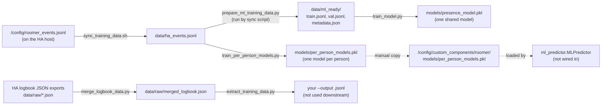

# ML models

Roomer logs every presence decision it makes, and you can train scikit-learn models from that log. This page covers the training scripts in [`scripts/`](https://github.com/owens-ben/roomer/tree/main/scripts): what each one reads and writes, the order to run them in, and how the result relates to the running integration.

!!! warning "Training a model does not change Roomer's predictions yet"
    `custom_components/roomer/ml_predictor.py` can load and run a trained model, but the coordinator never calls it (see [Architecture](architecture.md#ml_predictorpy)). These scripts are groundwork for that integration and a way to explore your own data. For the longer-term design, see the [ML enhancement proposal](ml-enhancement-proposal.md).

## Requirements

Run the scripts on any machine with Python 3.11 or later. It does not need to be the HA host.

| Script | Third-party packages |
| --- | --- |
| `extract_training_data.py`, `merge_logbook_data.py`, `prepare_ml_training_data.py` | None (standard library only) |
| `train_model.py`, `train_per_person_models.py` | `numpy`, `scikit-learn` |

```bash
pip install numpy scikit-learn
```

`train_per_person_models.py` checks the scikit-learn minor version to choose a `CalibratedClassifierCV` call. It is written for scikit-learn 1.x; 1.4 or later takes the `cv=2` path.

All paths are relative to the repo root. `data/` and `models/` are git-ignored, along with `*.pkl`, because they contain personal data about your household.

## Where the training data comes from

The integration's `EventLogger` appends one JSON line per person or pet on every poll to `/config/roomer_events.jsonl`. A presence event looks like this:

```json
{
  "timestamp": "2026-10-21T14:30:05-07:00",
  "entity_name": "Alice",
  "entity_type": "person",
  "room": "office",
  "confidence": 0.82,
  "raw_response": "ROOM: office",
  "indicators": ["computer: office_pc", "motion: office_motion", "computer: office_pc | motion: office_motion | LLM: office"],
  "detection_method": "llm",
  "time_features": {"hour": 14, "minute": 30, "day_of_week": 1, "is_weekend": false, "...": "..."},
  "sensor_summary": {"lights_on": ["office"], "motion_detected": ["office"], "computers_on": ["office_pc"], "...": []}
}
```

The same file also contains `room_transition` and `vision_identification` records. The training scripts skip any line without both `room` and `entity_name`.

!!! note
    The labels are Roomer's own past predictions, not ground truth. A model trained on them learns to imitate Roomer's combined LLM-plus-sensor decision, mistakes included. `MLPredictor.record_feedback()` was designed to collect real corrections in `/config/roomer_feedback.jsonl`, but nothing calls it yet and no script reads that file.

## Pipeline overview



The top row is the main path. The logbook path at the bottom is a separate, experimental way to build samples from Home Assistant's logbook; no other script consumes its output.

## Step by step

### 1. Sync the event log: `sync_training_data.sh`

```bash
./scripts/sync_training_data.sh            # HA config dir defaults to /config
./scripts/sync_training_data.sh /path/to/ha/config
```

What it does:

1. Creates `data/raw/` and `data/ml_ready/`.
2. Copies `<config>/roomer_events.jsonl` to `data/ha_events.jsonl` using `sudo cp`, then `sudo chown`s it to your user. It exits with an error if the file is missing.
3. Prints the event count and the first and last timestamps.
4. Runs `prepare_ml_training_data.py --input data/ha_events.jsonl --output data/ml_ready --val-split 0.2`.

If HA runs on another machine, copy `roomer_events.jsonl` over first (for example with `scp`) and pass the directory you copied it into.

### 2. Build features: `prepare_ml_training_data.py`

The sync script runs this for you. To run it by hand:

```bash
python3 scripts/prepare_ml_training_data.py \
    --input data/ha_events.jsonl \
    --output data/ml_ready \
    --val-split 0.2 \
    --min-confidence 0.0
```

| Argument | Meaning |
| --- | --- |
| `--input`, `-i` (required) | Events JSONL file. |
| `--output`, `-o` (required) | Output directory; created if missing. |
| `--val-split` | Fraction of samples held out for validation (default `0.2`). The shuffle uses a fixed seed of 42. |
| `--min-confidence` | Drop events below this confidence (default `0.0`). |

It writes three files to the output directory:

- `train.jsonl` and `val.jsonl`: one sample per line, `{features, label, label_idx, person, timestamp, confidence}`.
- `metadata.json`: `feature_names`, `num_features`, `rooms`, `people`, the train and validation sizes and `created_at`.

Features are normalised time-of-day flags, sensor counts, per-room light, motion and media flags, the original confidence and the indicator count, plus a one-hot `is_<person>` column per person and `is_pet`.

!!! warning "Edit `PEOPLE` first"
    The one-hot person columns and the per-person statistics come from a hard-coded `PEOPLE = ['Alice', 'Bob', 'Max']` near the top of the script. Change it to your household's names, spelled exactly as in Roomer, before you rely on those columns. Rooms are also hard-coded (`ROOMS`); any other room label becomes `unknown`.

### 3a. Train one shared model: `train_model.py`

```bash
python3 scripts/train_model.py
```

It takes no arguments. It reads `data/ml_ready/train.jsonl`, `val.jsonl` and `metadata.json`, trains a `RandomForestClassifier`, a `GradientBoostingClassifier` and a `LogisticRegression`, and prints train and validation accuracy for each. For the best model by validation accuracy it prints a classification report, the top 10 features (tree models only) and per-person validation accuracy. It saves the best model to `models/presence_model.pkl`.

Use it to compare model families on your data. `MLPredictor` does not read `presence_model.pkl`.

### 3b. Train per-person models: `train_per_person_models.py`

This script produces the file `MLPredictor` loads.

!!! warning "Set `PEOPLE` before running"
    The script ships with `PEOPLE = None` and loops over it in `main()`, so it fails with `TypeError: 'NoneType' object is not iterable` as is. The docstring mentions a `--people` flag, but there is no argument parsing. Edit the constant first:

    ```python
    PEOPLE = ["Alice", "Bob"]  # exactly as entity_name appears in roomer_events.jsonl
    ```

```bash
python3 scripts/train_per_person_models.py
```

What it does:

1. Loads `data/ha_events.jsonl` directly. It does **not** use `data/ml_ready/`, so run step 1 first.
2. For each name in `PEOPLE` with at least 50 events, it makes a random 80/20 split and trains a class-balanced random forest and a gradient-boosting model. It wraps the better one in an isotonic `CalibratedClassifierCV` so the probabilities are meaningful.
3. Prints a classification report, an uncertainty analysis (how many validation samples fall below `UNCERTAINTY_THRESHOLD = 0.4`) and the top 10 features for each person.
4. Saves everything to `models/per_person_models.pkl` as a dict with `models` (per person: `model`, `val_accuracy`, `train_size`, `top_features`, ...), `feature_names`, `rooms`, `people`, `uncertainty_threshold`, `trained_at` and `total_events`.

People with fewer than 50 events are skipped. If **every** person is skipped, the script crashes with a `NameError` on `feature_names` when it saves, so collect more data first.

### 4. Copy the model to Home Assistant

`MLPredictor` looks for the model at a fixed path:

```python
MODEL_PATH = Path("/config/custom_components/roomer/models/per_person_models.pkl")
```

The training script saves to `<repo>/models/per_person_models.pkl`. Nothing copies it automatically, so copy it yourself:

```bash
mkdir -p /config/custom_components/roomer/models
cp models/per_person_models.pkl /config/custom_components/roomer/models/
```

If HA runs on another machine, `scp` the file into that directory instead. Keep in mind:

- **HA needs scikit-learn to unpickle the model.** `manifest.json` only requires `aiohttp`, so HA does not install scikit-learn or numpy. Without them `MLPredictor` logs `Failed to load models ...` and disables prediction. The versions in HA's Python environment should match the ones you trained with.
- **HACS updates replace `custom_components/roomer/`.** A copied `models/` directory inside it can disappear when you update Roomer through HACS. Keep the original in your repo's `models/`.
- **The live features differ slightly from the training features.** `MLPredictor.extract_features()` rebuilds features from the live context, and a few definitions don't match what `EventLogger` logs. For example, `is_afternoon` is hours 12–18 at prediction time but 10–17 in `time_features`, and live `media_playing` counts only `playing` while the log also counts `paused`. Fix these if you wire the predictor in.

### Optional: build samples from the HA logbook

These two scripts work from Home Assistant **logbook** exports (JSON with an `entries` list, or a bare list) instead of Roomer's own log.

**`merge_logbook_data.py`** merges every `data/raw/*.json` plus any files passed as arguments. It deduplicates on `(entity_id, when)`, sorts by time and writes `data/raw/merged_logbook.json`, then prints entry counts per domain.

```bash
python3 scripts/merge_logbook_data.py [extra_export.json ...]
```

**`extract_training_data.py`** groups entries into 5-minute windows. For each window where a person location is known or a light, motion sensor, media player or tracker is active, it writes a sample with time features, a sensor summary, room indicators and `person_locations`:

```bash
python3 scripts/extract_training_data.py \
    --input data/raw/merged_logbook.json \
    --output data/logbook_samples.jsonl \
    [--append]
```

`person_locations` is filled in by matching Roomer binary sensors such as `binary_sensor.alice_in_office` against the module-level `PEOPLE` list. That list ships empty, and despite the comment nothing auto-detects names, so set it (lower-case, as in entity IDs) or every location stays `unknown`. The output format differs from `roomer_events.jsonl`, and none of the training scripts read it.

## Typical run

```bash
pip install numpy scikit-learn

# 1. Pull the event log and build data/ml_ready/
./scripts/sync_training_data.sh /config

# 2. (Optional) compare model families
python3 scripts/train_model.py

# 3. Train per-person models (after setting PEOPLE in the script)
python3 scripts/train_per_person_models.py

# 4. Install the model where MLPredictor looks for it
mkdir -p /config/custom_components/roomer/models
cp models/per_person_models.pkl /config/custom_components/roomer/models/
```

## Wiring the predictor in

If you want to take this further, the natural integration point is `LLMPresenceCoordinator._process_entity()`. You would call `get_ml_predictor(self.hass).predict(name, context, llm_confidence=guess.confidence, indicators=...)` and feed the result to `ConfidenceCombiner` as another weighted signal, plus call `notify_uncertainty()` when `uncertain` is true. You would also need to decide how scikit-learn gets installed (or make the feature optional), move `MODEL_PATH` somewhere HACS updates won't overwrite (for example via `hass.config.path()`), and add tests alongside `tests/test_ml_predictor.py`.
