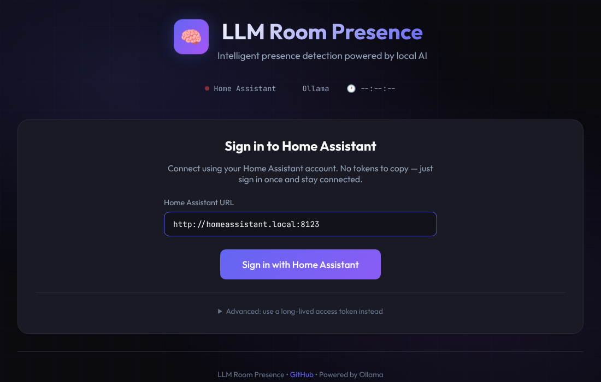

# Dashboard

[← Automations](automations.md) · [Guide home](README.md) · Next: [Troubleshooting →](troubleshooting.md)

Three ways to see who is where, from lightest to richest.

| | Needs | Best for |
|---|---|---|
| [**Lovelace card**](#1-the-lovelace-card) | One file | Dropping a presence list onto any dashboard |
| [**Lovelace dashboard**](#2-the-lovelace-yaml-dashboard) | Mushroom and card_mod from HACS | A full page inside Home Assistant |
| [**Standalone web dashboard**](#3-the-standalone-web-dashboard) | Docker (nginx) | A wall tablet or a separate screen |

> [!NOTE]
> Every picture on this page was rendered from the real code in this repository using **demo data** (Alice, Bob and
> Max). They are illustrations, not captures of a live home.

## 1. The Lovelace card


A compact card with one row per person or pet: an icon for the room, the room name, a confidence bar (green from 70 %,
amber from 40 %, red below), and up to three evidence chips. People who are `away` are dimmed.

**Install**

1. Copy [`www/whollm-card.js`](../www/whollm-card.js) to `/config/www/whollm-card.js`.
2. **Settings → Dashboards → ⋮ → Resources → Add resource**
   (turn on *Advanced mode* in your user profile if you do not see Resources).
   URL `/local/whollm-card.js`, type **JavaScript module**.
3. Hard-refresh the browser.

**Use**

```yaml
type: custom:whollm-card
title: Who is where
entities:
  - sensor.alice_room
  - sensor.bob_room
  - sensor.max_room
show_confidence: true      # default true
show_indicators: true      # default true
```

| Option | Default | |
|---|---|---|
| `entities` | required | List of `sensor.<name>_room` entities. |
| `title` | `Room Presence` | Card header. |
| `show_confidence` | `true` | The confidence bar and percentage. |
| `show_indicators` | `true` | The first three indicator chips. |

> [!TIP]
> Configure the card in YAML. The visual editor currently only handles a single entity and would replace your list.

## 2. The Lovelace YAML dashboard

A full multi-section dashboard in [`dashboard/whollm-dashboard.yaml`](../dashboard/whollm-dashboard.yaml).

**Needs** the [Mushroom](https://github.com/piitaya/lovelace-mushroom) and
[card-mod](https://github.com/thomasloven/lovelace-card-mod) frontend integrations (both in HACS).

**Install**

1. Copy the file to your Home Assistant config directory.
2. Add it as a dashboard in `configuration.yaml`:

   ```yaml
   lovelace:
     dashboards:
       whollm:
         mode: yaml
         title: WhoLLM
         icon: mdi:brain
         show_in_sidebar: true
         filename: whollm-dashboard.yaml
   ```

3. Restart Home Assistant.

   Leave out a top-level `mode: yaml` under `lovelace:`. That would switch your *default* dashboard to YAML mode as well.

   You can also paste the file into a new dashboard's raw configuration editor instead.

**Make it yours.** The file ships with the demo household. Replace these with your own entities:

| Replace | With |
|---|---|
| `sensor.alice_room`, `sensor.bob_room` | your people's room sensors |
| `binary_sensor.alice_in_office`, `…_in_living_room`, `…_in_kitchen`, `…_in_bedroom`, `…_in_bathroom`, `…_in_away` | your binary sensors (there is no `…_in_away` unless you created a room called `away`) |
| `binary_sensor.office_motion`, `light.*`, `media_player.*` | your own motion sensor, lights and media players |

## 3. The standalone web dashboard


A dark, responsive page that polls Home Assistant every 5 seconds and shows:

- a card per person and pet with room, confidence and evidence chips,
- a **room overview** that lights up occupied rooms,
- the raw **LLM analysis** (what the model answered and the evidence behind it),
- a **recent activity** timeline of room changes seen while the page is open,
- a **vision** panel for camera identification (see [limitations](#known-limitations)).

**Run it**

1. **Point it at your Home Assistant.** Open [`dashboard/nginx.conf`](../dashboard/nginx.conf) and replace
   `192.168.0.233:8123` with your Home Assistant host and port. It appears in the `/api/` and `/auth/token` blocks, in
   both the `proxy_pass` and `Host` lines.
2. Start it:

   ```bash
   cd dashboard
   docker compose up -d
   ```

3. Open `http://<your-host>:3380` (change the port with the `DASHBOARD_PORT` environment variable).

> [!IMPORTANT]
> The `HA_URL` variable in `docker-compose.yml` is **not used** by `nginx.conf`. Editing the file in step 1 is what
> counts. The page needs the nginx proxy (or an equivalent reverse proxy that forwards `/api/` and `/auth/token`),
> so serving `index.html` with a plain static server will not work.

**Sign in**



1. Enter the address of Home Assistant **as your browser sees it**, for example `http://homeassistant.local:8123`.
2. Click **Sign in with Home Assistant**, approve the request, and you are sent back to the dashboard.

The sign-in uses Home Assistant's own OAuth flow, so there is no token to copy. Your session is kept in the browser's
local storage. Prefer a token? Open **Advanced** and paste a long-lived access token (created on your Home Assistant
profile page).

The nginx config deliberately does not send `X-Forwarded-For`. Home Assistant rejects proxied requests from proxies it
does not trust, unless the proxy's IP is in `http.trusted_proxies`.

### Known limitations

- **Fixed room tiles.** The overview shows office, living room, bedroom, kitchen, bathroom, entry and away. For other
  rooms, edit `CONFIG.rooms` and `CONFIG.roomIcons` near the top of the script in `dashboard/index.html`.
- **Vision panel and the Identify Now button do not work yet.** They still use the old integration name
  (`llm_presence`). Run `whollm.identify_person` from Home Assistant instead, and see the result on
  `sensor.vision_last_identification`.
- **The timeline is not history.** It is built in your browser from the changes it sees while open. Closing the page
  clears it.
- The page title still says "LLM Room Presence".

See [Status & roadmap](status.md#known-issues) for the full list.
