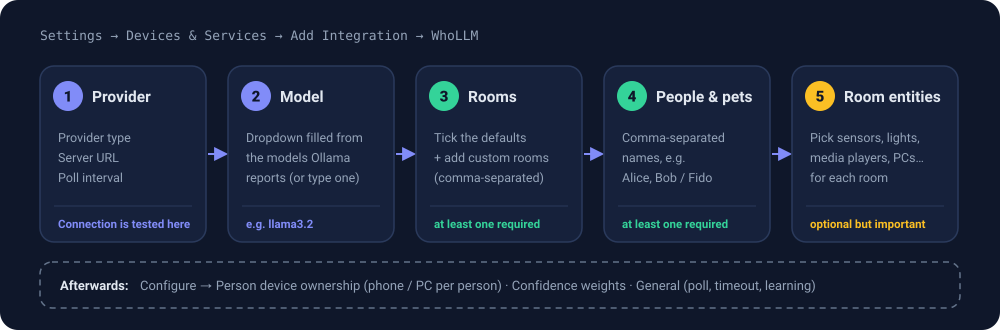

# Getting started

[← Guide home](README.md) · Next: [Configuration →](configuration.md)

From nothing to a working `sensor.<name>_room` in about 15 minutes, most of it waiting for a model download.



## What you need

| Requirement | Notes |
|---|---|
| **Home Assistant 2024.1 or newer** | Any install type. |
| **Ollama** reachable from Home Assistant | Same machine or elsewhere on your network. About 2 GB of disk for the default model. |
| **A few sensors** | Motion sensors, lights, media players, a PC power sensor, phone trackers. The more you have, the better the answers. |

## 1. Install Ollama and pull a model

```bash
curl -fsSL https://ollama.com/install.sh | sh
ollama pull llama3.2          # text reasoning, about 2 GB
```

Optional, only if you want camera identification later:

```bash
ollama pull moondream         # vision model WhoLLM uses by default
```

> [!IMPORTANT]
> If Ollama runs on a **different machine** than Home Assistant, it must listen on the network. By default it only
> listens on `127.0.0.1`. Start it with `OLLAMA_HOST=0.0.0.0` (for the systemd service, add it with
> `systemctl edit ollama`), then check from the Home Assistant host:
>
> ```bash
> curl http://<ollama-host>:11434/api/tags
> ```
>
> You should get JSON listing your models. If that fails, the wizard will fail too.

## 2. Install the integration

**HACS (recommended)**

1. HACS → ⋮ menu → **Custom repositories**.
2. Add `https://github.com/owens-ben/WhoLLM` with category **Integration**.
3. Find **WhoLLM** in HACS, install it, then **restart Home Assistant**.

**Manual**

1. Copy the `custom_components/whollm` folder from this repo into your Home Assistant
   `config/custom_components/` directory.
2. Restart Home Assistant.

## 3. Run the setup wizard

**Settings → Devices & Services → Add Integration → WhoLLM**

| Step | What to enter | Tips |
|---|---|---|
| **Provider** | Provider `ollama`, the Ollama URL, and a poll interval | `localhost` means *Home Assistant's* localhost. If Ollama is on another machine, use its IP address. The connection is tested before you can continue. |
| **Model** | Pick from the models Ollama reports | `llama3.2` is a good default. You can also type a model name. |
| **Rooms** | Tick the rooms you want, and add custom ones (comma-separated) | At least one is required. Room names are lower-cased with underscores, so "Guest Room" becomes `guest_room`. |
| **People & pets** | Comma-separated names, for example `Alice, Bob` and `Fido` | At least one person or pet is required. Names become part of the entity IDs. |
| **Room entities** | For each room, pick the sensors and devices that live there | Optional, but this is the most important step. See [Configuration](configuration.md#room-entity-mapping). |

> [!NOTE]
> Setup waits for the first round of detection, so it can take a little while on a slow model.

> [!WARNING]
> The provider, URL, model, rooms, people and pets are set **only** in this wizard. To change them later you have to
> remove the integration and add it again. Entity mapping, device ownership, weights and timing can be changed from
> **Configure**. See [Configuration](configuration.md#where-each-setting-lives).

## 4. Tell WhoLLM whose devices are whose

**Settings → Devices & Services → WhoLLM → Configure → Person device ownership**

Assign each person their own devices: their PC, their phone's `device_tracker`, their car. This gives two things:

- A `device_tracker` that reports *not home* makes WhoLLM answer **away** straight away, without asking the LLM.
- An active device that you also placed in a room counts for extra weight toward its owner.

Then **reload** the integration (⋮ next to WhoLLM → **Reload**). Options are read when the integration loads, so they do
not take effect until you do.

> [!WARNING]
> **Known issue:** each *Configure* page currently saves on its own and replaces what the other pages saved. Treat it
> as "the last page you saved is the one that sticks", and re-check your settings after saving. Details and the
> status of the fix are in [Status & roadmap](status.md#known-issues).

## 5. Check that it works

Open **Developer Tools → States** and filter for `_room`. You should see one sensor per person and pet:

```text
sensor.alice_room
  state: office
  attributes:
    confidence: 0.82
    indicators:
      - "motion: office_motion"
      - "computer: alice_pc"
      - "motion: office_motion | computer: alice_pc | LLM: office"
    raw_response: "ROOM: office"
    entity_type: person
    friendly_name: Alice Room
```

Walk into another room and wait a poll or two. The state should follow you.

Confidence will look lower than you expect if you mapped few sensors. That is normal and explained in
[How it works](how-it-works.md#signals-weights-and-confidence). The fix is more mapped sensors, not a different model.

## 6. Use it

Every person gets a `binary_sensor.<name>_in_<room>` that is `on` while they are in that room:

```yaml
automation:
  - alias: "Alice's office lighting"
    trigger:
      - platform: state
        entity_id: binary_sensor.alice_in_office
        to: "on"
    action:
      - service: light.turn_on
        target:
          entity_id: light.office
        data:
          brightness_pct: 80
```

More recipes and ready-made blueprints are in [Automations](automations.md). To put it on a screen, see
[Dashboard](dashboard.md).

## If something is off

| Symptom | Go to |
|---|---|
| The wizard says it cannot connect | [Troubleshooting → connection](troubleshooting.md#the-wizard-says-unable-to-connect-to-the-llm-provider) |
| Confidence is always low | [Troubleshooting → low confidence](troubleshooting.md#confidence-is-always-low) |
| It puts the wrong person in a room | [Troubleshooting → wrong person](troubleshooting.md#the-wrong-person-gets-the-room) |
