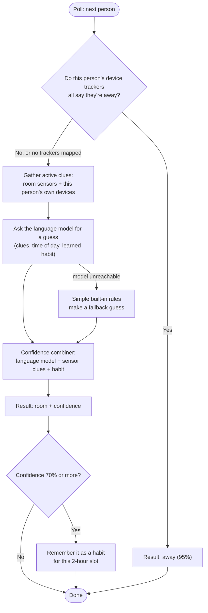

# How it works

Roomer runs on a timer. At each check (the **poll interval**, every 10 seconds
by default) it looks at the sensors you've given it and makes a fresh guess for
every person and pet you track.

This page follows one guess from start to finish.

## The example household

Alice and Bob share a house. It's a Tuesday afternoon.

- Alice's phone is connected to the home Wi-Fi, so its **device tracker** says
  `home`. (In Home Assistant, a *device tracker* is an entity that reports
  whether a device is home or away.)
- Alice's desktop PC in the office is switched on.
- The office motion sensor has gone quiet, because Alice has been sitting
  still at her desk for a while.
- Bob's phone reports `not_home`. He's at work.

In Roomer's settings, the office PC has been mapped to the **office** room *and*
to **Alice** as a device she owns. Both phones have been mapped to their owners.
You'll set this up yourself in [Map your rooms](map-rooms.md).

## The pipeline, per person

On every poll, Roomer runs each person through these steps:

### 1. Is the person home at all?

Roomer looks only at the `device_tracker` entities you've assigned to that
person. If at least one says `home`, Roomer carries on. If every tracker says
`not_home` or names another zone (like `work`), Roomer stops right there and
reports **away** with 95% confidence. If the trackers are all unavailable, or the
person has none, Roomer can't rule them out and carries on.

**Bob:** his phone says `not_home`, so `sensor.bob_room` becomes `away`. That
saves a call to the language model.

**Alice:** her phone says `home`, so she moves on to step 2.

Pets skip this step, since they don't carry phones.

### 2. Gather the clues

Roomer collects every mapped entity that is currently **active**: on, playing,
open, detected, home or occupied. Each clue is tagged with its room and a type
(computer, motion, light and so on).

For Alice, this includes:

- `switch.alice_pc`, which is on and mapped to the office, so it's a clue for
  *anyone* who's home.
- The same PC again, as a device Alice owns. This clue counts **only for Alice**.

The quiet motion sensor isn't active, so it isn't a clue this time.

### 3. Ask the language model

Roomer sends the clues, the time of day, and any habit it has learned for Alice
to the language model (Ollama by default). It asks the model to pick one of your
rooms and say how sure it is. Say it answers *office, 85%*.

If the model can't be reached or times out, Roomer falls back to simple built-in
rules instead (for example, "a computer is on, so the person is probably in that
computer's room") and gives that guess a lower confidence.

### 4. Combine the evidence

The model's answer isn't the final word. The **confidence combiner** scores each
room by adding up the evidence:

- each active sensor clue, weighted by its type (a computer in use counts for
  much more than a light being on),
- the model's guess, scaled by its confidence,
- the learned habit for this time of day, if there is one.

The room with the highest score wins, and the score becomes the confidence.

??? note "The arithmetic, for the curious"
    With the default weights:

    | Evidence | Room | Points |
    |---|---|---|
    | `switch.alice_pc` mapped to office (computer) | office | 0.85 |
    | Alice owns `switch.alice_pc` (computer) | office | 0.85 |
    | Language model says office at 85% × weight 0.50 | office | 0.425 |
    | **Total** | **office** | **2.125** |

    The total is divided by the sum of the three biggest weights
    (camera 0.95 + computer 0.85 + media 0.80 = 2.6), giving **0.82**. You can
    change the weights under
    [Confidence Weights](map-rooms.md#confidence-weights).

So `sensor.alice_room` becomes **`office`**, with a `confidence` attribute of
`0.82` and an `indicators` attribute listing the clues it used.

### 5. Learn habits

When a result is 70% confident or more, and pattern learning is on, Roomer
remembers it for that person in a two-hour time slot (for example, *Alice, 14:00
to 16:00, office*). Next time it's unsure at that time of day, the habit nudges
the guess. Roomer starts with no habits and builds them up as it runs.

## What this means for you

- **Personal devices make the biggest difference.** A PC, phone or console that
  belongs to one person is the clearest way to tell people apart.
- **Shared sensors help with *where*, not *who*.** Motion and lights count the
  same for everyone at home. See [What you'll need](requirements.md#how-good-are-your-signals).
- **The poll interval is a trade-off.** Each poll asks the language model once
  for every person at home and every pet. On slower hardware, raise the interval
  (up to 300 seconds) so the model can keep up.

Next: [What you'll need](requirements.md).
