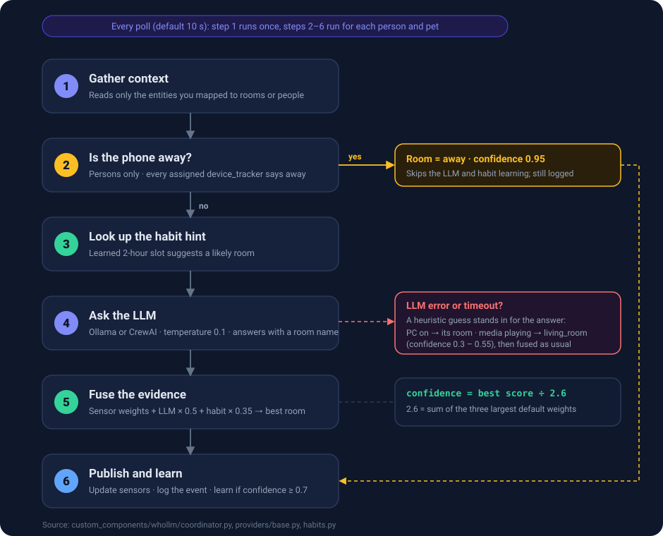

# How it works

[← Configuration](configuration.md) · [Guide home](README.md) · Next: [Entities & services →](entities-and-services.md)

Read this when you want to know *why* WhoLLM picked a room, or how to make it pick better.

## The short version

On every poll, for every person and pet, WhoLLM:

1. checks whether their phone says they are away,
2. asks a local LLM which room they are in,
3. **weighs that answer against the sensors you mapped** and what it has learned about their habits,
4. publishes the winning room and a confidence number.

The LLM is one voice among several. The sensors usually decide.



## Step by step

### 1. Gather context (once per poll)

WhoLLM reads the state of every entity you mapped to a room or assigned to a person, and nothing else. Each is sorted
into a bucket by its [hint type](configuration.md#hint-types-are-guessed-from-the-entity-id): lights, motion, media,
computers, doors, camera AI, climate, device trackers. Entities that do not fit a bucket (the generic "appliance"
type) are not listed on their own, but while active they still appear under *Active indicators* in the prompt and
count as evidence (see step 5).

### 2. Is the phone away? (people only)

If a person has `device_tracker` entities assigned and **all** of them report away (`not_home`, or any zone other than
`home`), the answer is `away` with confidence 0.95. The LLM is not asked. Pets skip this step.

### 3. Habit hint

If WhoLLM has learned where this person usually is at this time of day, that becomes a hint in the prompt and a
small vote in step 5. See [Habits](#habits).

### 4. Ask the LLM

The LLM gets a short, structured summary and must answer with a single line, `ROOM: <name>`, from your list of rooms.
It runs with a low temperature (0.1) and a tiny output limit, so answers are fast and consistent.

<details>
<summary><strong>Show a real prompt</strong> (generated by the integration's own formatter)</summary>

System prompt:

```text
You are a smart home presence detection AI. Determine which room Alice is most likely in.

REASONING RULES (priority order):
1. DEVICE TRACKER: "not_home"/"away" → respond "away"
2. CAMERA AI DETECTION: Very reliable - trust it
3. TV/MEDIA PLAYING: Person is in that room
4. PC/COMPUTER ON: Person at their desk
5. LIGHTS ON: Strong indicator
6. MOTION: Recent motion is a good indicator
7. TIME: Use only as tie-breaker

Camera AI and sensor data OVERRIDE time-of-day assumptions.

OUTPUT FORMAT (exactly):
ROOM: <room_name>

Valid rooms: office, living_room, bedroom, kitchen, bathroom, entry
```

Prompt:

```text
CURRENT TIME: 14:05 (Tuesday)
MOTION SENSORS:
  - Office: MOTION NOW
  - Kitchen: none (last 42m ago)
COMPUTERS (PC on = person at desk):
  - Alice Pc: ON/ACTIVE in office
MEDIA DEVICES:
  - Living Room Tv: off (3h ago)
LIGHTS:
  - Office: ON (80%) (2h ago)
DEVICE TRACKERS:
  - Alice Iphone: HOME

LEARNED PATTERN HINT (use as context, not absolute truth):
Based on learned patterns, Alice is usually in office at this time.
Confidence: 80%
Note: This is a learned pattern - actual sensor data should override if contradictory.

ACTIVE INDICATORS:
  - motion: binary_sensor.office_motion in office
  - computer: switch.alice_pc in office
```

Sections are added in the order shown (time, camera AI, motion, computers, media, lights, doors, device trackers,
climate, habit hint, active indicators) until a 4,000 character budget is used up. In a very large setup the
lowest-priority sections at the end are the ones that get dropped.

</details>

Pets get a different system prompt: pets follow their owners, often sleep in bedrooms at night, and motion in a dark
room might be them. Computers are not counted as evidence for pets.

### 5. Weigh the evidence

This is where the answer is decided. Every **active** mapped entity votes for the room it lives in, with the weight of
its hint type. The LLM's room votes with `0.5 × its certainty`, and the habit hint votes with `0.35 × its confidence`.
The room with the highest total wins. (A media player that is `playing` counts its full weight, `paused` counts 70 %,
and one that is merely `on` counts 0.1.)

The LLM's own certainty is a flat 0.7 in practice, because the prompt asks it for a room name only, not a number. So
the LLM's vote is normally worth `0.7 × 0.5 = 0.35`, about the same as one light.

### 6. Publish and learn

The winning room and confidence go to the person's sensors. The result is appended to the
[event log](configuration.md#what-gets-stored-on-disk), room changes are logged, and if confidence is at least 0.7 and
learning is on, the observation teaches the [habit](#habits) model.

## Signals, weights and confidence


A room's score is the **sum** of the weights of everything pointing at it. Confidence is:

```text
confidence = best room's score ÷ (sum of the three largest weights), capped at 1.0
```

With the defaults the divisor is 0.95 + 0.85 + 0.80 = **2.6**. That means confidence measures *how much evidence you
have*, not how clever the model is. Here is a real run through the integration's own combiner, with default weights:

| What WhoLLM knows | Score for `office` | Confidence |
|---|---:|---:|
| Only the LLM says `office` (0.5 × 0.7) | 0.35 | **13 %** |
| + office motion sensor active (0.60) | 0.95 | **37 %** |
| + Alice's PC is on, mapped to the office (0.85) | 1.80 | **69 %** |
| + learned habit says office at 80 % (0.35 × 0.8) | 2.08 | **80 %** |
| + the PC is also assigned to Alice (+0.85) | 2.93 | **100 %** (capped) |

Things to take from this:

- **An LLM answer alone is about 13 % confident.** If every prediction reads low, you have not mapped enough sensors.
- **Three or four agreeing signals reach "high".** The Lovelace card colours 70 % and up green, 40–69 % amber and
  below 40 % red.
- **Learning needs confident observations.** Habits only form from predictions at 70 % or more, which needs real
  sensor evidence behind them.
- **Weights are the tuning knob.** Raise the weights of the signals you trust (a camera, a PC), lower the noisy ones.
  Because the divisor is built from your three largest weights, lowering them raises overall confidence.

### Shared signals in multi-person homes

Mapped room entities are **shared evidence**: an active entity votes for its room on behalf of *every* person.
Only [device ownership](configuration.md#person-device-ownership) is person-specific, and it only adds extra weight for
the owner.

Real consequence, from the same combiner: Bob is alone with the TV playing and the LLM agrees. He scores
`living_room` at 44 %. Now Alice sits down in the office (motion plus her PC). Bob's evidence for the office
(0.60 + 0.85 = 1.45) outweighs his TV and LLM vote (0.80 + 0.35 = 1.15), and Bob is placed in the **office** at 56 %.

How to get better results in a shared home:

- Prefer **person-specific signals**: a PC that only one person uses, a phone-based presence sensor, a camera with
  person recognition.
- **Assign devices** to their owners so the owner gets the extra weight.
- Use `device_tracker` assignments so people who are out are `away` and never compete for rooms.
- Raise the weights of person-specific signals and lower generic ones such as lights and motion.

## When things fail

| What happens | What WhoLLM does |
|---|---|
| Ollama is unreachable or times out | Retries once after a short pause, then uses a **rule-based fallback guess** (below). |
| The LLM answers with something that is not a valid room | Treated as `unknown` for the LLM's vote. Sensors and habits can still decide. |
| No evidence at all | State is `unknown` with confidence 0. |
| The phone says everyone's trackers are away | `away`, 0.95, no LLM call. |

**Fallback guess** (used in place of the LLM's answer, then weighed as usual):

| Who | Rule | Confidence |
|---|---|---:|
| Person | A PC is on → that PC's room | 0.50 |
| Person | A media player is playing → `living_room` (the player's own room is not consulted) | 0.55 |
| Person | Otherwise → `living_room` if it exists, else the first room | 0.30 |
| Pet | Media playing → `living_room` | 0.40 |
| Pet | A PC is on → that PC's room | 0.35 |
| Pet | Otherwise → `bedroom` if it exists, else the first room | 0.30 |

When this happens, the sensor's `raw_response` attribute holds the error text instead of an LLM answer. That is the
quickest way to spot a failing provider.

## Habits

WhoLLM starts with no assumptions and learns from your household.

- The day is split into **two-hour windows** (0–2, 2–4, …).
- A prediction at **70 % confidence or more** teaches the window: same room as before raises the stored confidence
  (a running average, capped at 95 %); a different room replaces it only if the new observation is stronger.
- A learned habit then adds a hint to the prompt and a small vote (`0.35 × confidence`) in the weighing step.
- Pets are learned the same way. Learning can be switched off in **Configure → General Settings**.

> [!NOTE]
> Learned habits currently live in memory and are not saved to disk automatically, so they start fresh after every
> Home Assistant restart. See [Status & roadmap](status.md#known-issues).

## What gets logged

Every poll appends one JSON line per person or pet to `/config/whollm_events.jsonl`:

```json
{
  "timestamp": "2026-02-11T14:05:12+00:00",
  "entity_name": "Alice",
  "entity_type": "person",
  "room": "office",
  "confidence": 0.8,
  "raw_response": "ROOM: office",
  "indicators": ["motion: office_motion", "computer: alice_pc", "LLM: office"],
  "detection_method": "llm",
  "time_features": { "...": "hour, day of week, and so on" },
  "sensor_summary": { "...": "which lights, motion and media were active" }
}
```

Room moves and vision identifications are logged too. This file is the raw material for
[ML training](ml-and-training-data.md).

## Why it is built this way

- **Local first.** Presence data is about as private as data gets. Everything runs on your network.
- **Weak signals, strong together.** Each sensor alone is unreliable. Weighing several is far sturdier than trusting
  one.
- **Always an answer.** Each layer (phone, LLM, fallback, habits) is there so a failure in one does not leave you with
  nothing.

Next: [look up entities and services →](entities-and-services.md)
