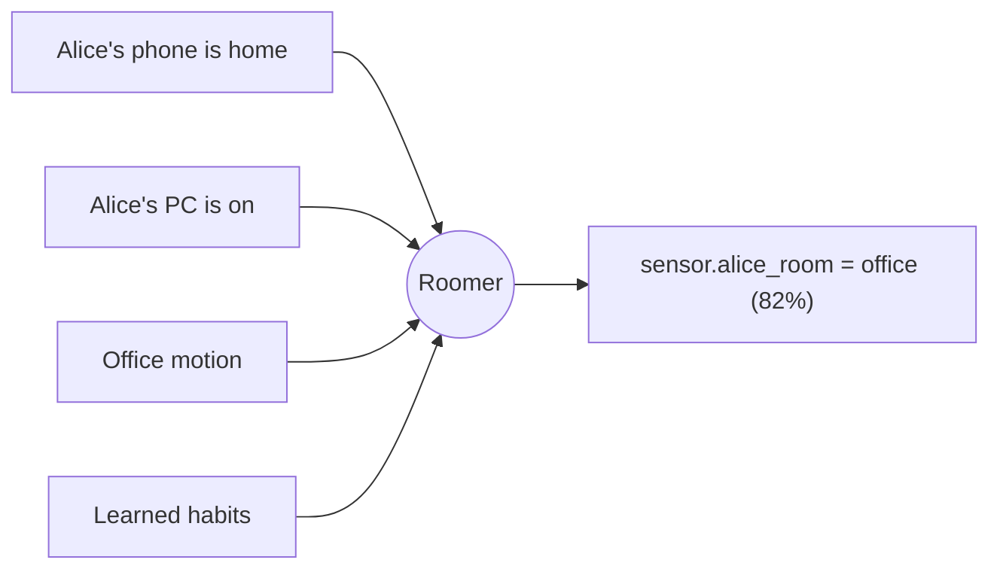

# Roomer

**Know *who* is in which room, not just that a room is occupied.**

Most smart homes can tell you that someone is in the office. Roomer is a
[Home Assistant](https://www.home-assistant.io/) integration that tries to tell
you *which person* it is. It does this by combining the clues your home already
has, the same way you would if you were guessing.

No single sensor gives a definite answer. Put together, they're usually enough
for a good guess.

-   :material-account-search:{ .lg .middle } __Who, not just whether__

    ---

    You get one sensor per person (and pet) showing their current room, plus an
    on/off sensor for each person in each room, ready to use in automations.

-   :material-puzzle-outline:{ .lg .middle } __Uses what you already have__

    ---

    Phones, personal computers, motion sensors, lights, media players, doors and
    camera person-detection all count as evidence. You map them to rooms in the
    UI, with no YAML needed.

-   :material-percent-outline:{ .lg .middle } __Shows its confidence__

    ---

    Every guess comes with a confidence score and a list of the clues behind it,
    so you can see *why* Roomer thinks Alice is in the office.

-   :material-home-lock:{ .lg .middle } __Runs locally__

    ---

    The reasoning step runs on a local language model through
    [Ollama](https://ollama.com) by default, so your home's data stays on your
    network. Roomer learns daily habits as it runs.

!!! info "Alpha software"
    Roomer is in alpha. It works, but expect rough edges, and check
    [Accuracy & limits](using/accuracy.md) to see what it can and can't do.

Roomer was previously called **WhoLLM**. If you're upgrading, read
[Migrating from WhoLLM](migrating.md).

[Get started](getting-started/how-it-works.md){ .md-button .md-button--primary }
